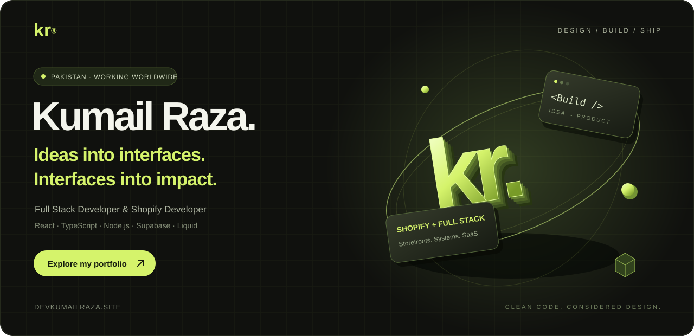
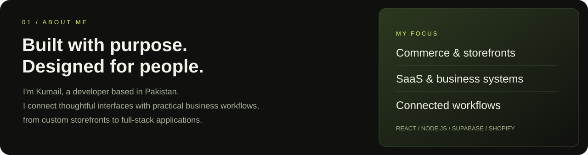
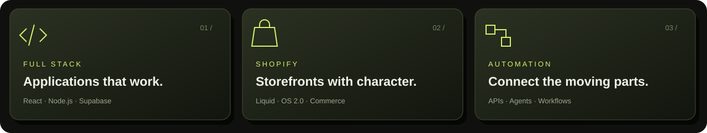
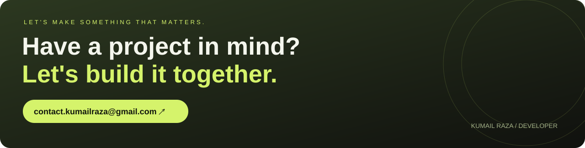

<b>kr. / KUMAIL RAZA</b>

<a href="#about">About</a> &nbsp; / &nbsp;
<a href="#services">Expertise</a> &nbsp; / &nbsp;
<a href="#work">Selected work</a> &nbsp; / &nbsp;
<a href="#stack">Tech stack</a> &nbsp; / &nbsp;
<a href="#contact">Let's talk ↗</a>

 

  

02 / EXPERTISE

<h2>From the first idea to the final experience.</h2>

I help businesses build responsive websites, custom storefronts and applications that support everyday operations.

<table>
<tr>
<td width="33%" valign="top"><h3>Web applications</h3>
React interfaces, dashboards, CRM systems, REST APIs, authentication and database workflows.
<a href="https://devkumailraza.site/full-stack-development.html">Explore full-stack services ↗</a></td>
<td width="33%" valign="top"><h3>Shopify development</h3>
OS 2.0 theme customization, Liquid sections, product layouts, storefront navigation and theme fixes.
<a href="https://devkumailraza.site/shopify-development.html">Explore Shopify services ↗</a></td>
<td width="33%" valign="top"><h3>Websites &amp; commerce</h3>
WordPress, WooCommerce, Webflow and Framer websites with responsive layouts and clear content.
<a href="https://devkumailraza.site/#work">Explore website projects ↗</a></td>
</tr>
</table>

 

03 / SELECTED WORK

<h2>A closer look at what I build.</h2>

Storefronts, applications and digital experiences from my portfolio.

<a href="#shopify">Shopify</a> &nbsp; · &nbsp;
<a href="#applications">Full stack</a> &nbsp; · &nbsp;
<a href="#automation">AI &amp; automation</a> &nbsp; · &nbsp;
<a href="#webflow">Webflow &amp; Framer</a> &nbsp; · &nbsp;
<a href="#wordpress">WordPress</a>

 

<h3>Shopify storefronts</h3>
<table>
<tr>
<td width="50%" valign="top">

Shopify / Liquid / JavaScript / CSS

<h3>Zeina Atelier</h3>

<b>An editorial storefront for wedding stationery.</b>

Custom Shopify OS 2.0 theme work for a refined wedding stationery brand. Warm neutrals, expressive collections and reusable sections.

<a href="https://devkumailraza.site/case-studies/zeina-atelier-shopify-theme.html"><b>Case study ↗</b></a>

 
</td>
<td width="50%" valign="top">

Shopify / Liquid / JavaScript

<h3>ScentedVenture</h3>

<b>The details that make a storefront feel finished.</b>

Shopify theme cleanup and storefront improvements across product templates, navigation, forms and brand elements.

<a href="https://scentedventure.com/"><b>Visit website ↗</b></a> &nbsp; · &nbsp; <a href="https://devkumailraza.site/case-studies/scentedventure-shopify-improvements.html"><b>Case study ↗</b></a>

 
</td>
</tr>
</table>
 

<h3>Full-stack applications</h3>
<table>
<tr>
<td width="50%" valign="top">

React / TypeScript / Node.js / Supabase / PostgreSQL

<h3>Real Estate Operations</h3>

<b>One platform. Every property workflow.</b>

A SaaS platform connecting lead management, CRM, property operations and everyday business workflows.

<a href="https://real-estate-automation-agent.onrender.com/"><b>Visit website ↗</b></a> &nbsp; · &nbsp; <a href="https://devkumailraza.site/case-studies/real-estate-crm-saas.html"><b>Case study ↗</b></a> &nbsp; · &nbsp; <a href="https://github.com/kumailraza5/Real-Estate-Automation-Agent"><b>Source code ↗</b></a>

 
</td>
<td width="50%" valign="top">

React / Express / Supabase / Tailwind

<h3>Event Management System</h3>

<b>From discovery to the final QR check-in.</b>

A role-based event platform for admins, organizers and attendees, with booking, feedback and data-driven planning.

<a href="https://devkumailraza.site/case-studies/event-management-system.html"><b>Case study ↗</b></a>

 
</td>
</tr>
<tr>
<td width="50%" valign="top">

React / TypeScript / Supabase

<h3>Aurevo Store</h3>

<b>Premium products. A considered shopping experience.</b>

A responsive e-commerce experience for watches and perfumes, with database integration, authentication and cart workflows.

<a href="https://aurevostore.pk/"><b>Visit website ↗</b></a> &nbsp; · &nbsp; <a href="https://github.com/kumailraza5/Aurevo.store"><b>Source code ↗</b></a>

 
</td>
<td width="50%" valign="top">

React / TypeScript / Node.js / Supabase

<h3>USP OBE System</h3>

<b>Learning outcomes, made measurable.</b>

An education platform connecting courses, assessments and learning outcomes through role-based dashboards.

<a href="https://obe-system-w2wd.onrender.com/"><b>Visit website ↗</b></a> &nbsp; · &nbsp; <a href="https://github.com/kumailraza5/OBE-System"><b>Source code ↗</b></a>

 
</td>
</tr>
<tr>
<td width="50%" valign="top">

React / TypeScript / Tailwind / Framer Motion

<h3>Elite Motors</h3>

<b>A showroom experience, reimagined for the web.</b>

An animated luxury car showroom interface with responsive vehicle listings and a clean presentation.

<a href="https://carshowroom-ws42.onrender.com/"><b>Visit website ↗</b></a> &nbsp; · &nbsp; <a href="https://github.com/kumailraza5/carshowroom_UI"><b>Source code ↗</b></a>

 
</td>
<td width="50%" valign="middle" align="center"><h3>Your project could be next.</h3>
Let's build something around your business.
<a href="mailto:contact.kumailraza@gmail.com">Discuss your idea ↗</a></td>
</tr>
</table>
 

<h3>AI &amp; automation</h3>
<table>
<tr>
<td width="50%" valign="top">

Python / Flask / MySQL / JavaScript

<h3>Smart Exam Generator</h3>

<b>A smarter way to build and manage exams.</b>

A rule-based paper generation system with difficulty-balanced question allocation and connected teacher/student workflows.

<a href="https://devkumailraza.site/#work"><b>View in portfolio ↗</b></a>

 
</td>
<td width="50%" valign="top">

Node.js / Python / Supabase / AI APIs

<h3>Restaurant Voice Agent</h3>

<b>Turning conversations into connected workflows.</b>

Voice agent workflow design for restaurant calls, menu questions and order handoff, connected to business data.

<a href="https://devkumailraza.site/#work"><b>View in portfolio ↗</b></a>

 
</td>
</tr>
<tr>
<td width="50%" valign="top">

Python / YOLO / Computer vision

<h3>Classroom Gadget Detection</h3>

<b>Computer vision for exam environments.</b>

A real-time computer vision project focused on electronic gadgets, small papers and posture-based monitoring.

<a href="https://devkumailraza.site/#work"><b>View in portfolio ↗</b></a>

 
</td>
<td width="50%" valign="middle" align="center"><h3>Your project could be next.</h3>
Let's build something around your business.
<a href="mailto:contact.kumailraza@gmail.com">Discuss your idea ↗</a></td>
</tr>
</table>
 

<h3>Webflow &amp; Framer websites</h3>
<table>
<tr>
<td width="50%" valign="top">

Webflow / JavaScript / HTML5 / CSS3

<h3>Dux Design</h3>

<b>UX/UI agency portfolio &amp; clean layouts.</b>

Developed a modern, responsive website in Webflow for Dux Design, showcasing their UX/UI expertise, case studies, services, and team with clean layouts and interactive elements.

<a href="https://duxdesign-site.webflow.io/"><b>Visit website ↗</b></a>

 
</td>
<td width="50%" valign="top">

Webflow / JavaScript / HTML5 / CSS3

<h3>Agile by Design</h3>

<b>Design-led brand identity and CMS architecture.</b>

Developed a responsive, modern website in Webflow for Agile by Design, incorporating custom layouts, CMS integration, and interactive elements to effectively showcase the client’s services and brand identity.

<a href="https://www.agilebydesign.com/"><b>Visit website ↗</b></a>

 
</td>
</tr>
<tr>
<td width="50%" valign="top">

Framer / JavaScript / HTML5 / CSS3

<h3>Wimbo</h3>

<b>Social discovery and event community platform.</b>

Developed a modern, responsive website for Wimbo, a social and event platform, featuring user profiles, event creation, trending videos, and community engagement.

<a href="https://wimbo.au/"><b>Visit website ↗</b></a>

 
</td>
<td width="50%" valign="top">

Framer / JavaScript / HTML5 / CSS3

<h3>SyncSpace</h3>

<b>Virtual-reality social and shared space platform.</b>

Developed a sleek, responsive website for SyncSpace using Framer, showcasing a virtual-reality social platform built to bring people together in shared VR spaces. Features include avatar building, friend connections, group sessions, and subscription-based pricing plans.

<a href="https://syncspace.framer.ai/"><b>Visit website ↗</b></a>

 
</td>
</tr>
<tr>
<td width="50%" valign="top">

Framer / JavaScript / HTML5 / CSS3

<h3>Likely</h3>

<b>Predictive conversion intelligence platform.</b>

Developed a sleek, responsive website in Framer for Likely, a predictive conversion intelligence platform. The site showcases key statistics, interactive features like a live ROI calculator, service highlights, and client testimonials, all with clean layouts, modern visuals, and conversion-focused design.

<a href="https://www.likely.to/"><b>Visit website ↗</b></a>

 
</td>
<td width="50%" valign="top">

Framer / JavaScript / HTML5 / CSS3

<h3>Xinovix</h3>

<b>No-code &amp; low-code digital agency presence.</b>

Developed the responsive, modern website for Xinovix using Framer — a design-forward no-code/low-code platform. The site features intuitive navigation, a blog section to share insights, career pages to attract talent, and clean, professional aesthetics tailored to the brand’s tech-driven identity.

<a href="https://xinovix.framer.website/"><b>Visit website ↗</b></a>

 
</td>
</tr>
</table>
 

<h3>WordPress &amp; WooCommerce</h3>
<table>
<tr>
<td width="50%" valign="top">

WordPress / Elementor / PHP / CSS3

<h3>RIGROCK L.L.C.</h3>

<b>Global industrial sourcing &amp; oil and gas services.</b>

Developed the official RIGROCK L.L.C. website using Elementor in WordPress. Designed a clean, responsive, and user-friendly layout to showcase their services in oil &amp; gas, industrial equipment, and global sourcing, highlighting company profile, products, and contact information effectively.

<a href="https://rigrock.ae/"><b>Visit website ↗</b></a>

 
</td>
<td width="50%" valign="top">

WordPress / Bricks / WooCommerce / CSS3

<h3>From The Walled Garden</h3>

<b>Artisan candle brand and bespoke eCommerce store.</b>

Built a responsive online shop using Bricks Builder on WordPress for a hand-poured artisan candle brand. The site features clean layouts, product collections, ethical ingredient messaging and an elegant eCommerce checkout.

<a href="https://fromthewalledgarden.com/shop/"><b>Visit website ↗</b></a>

 
</td>
</tr>
<tr>
<td width="50%" valign="top">

WordPress / Bricks / JavaScript / CSS3

<h3>Ubuntu Productions</h3>

<b>Creative agency portfolio for branding and media.</b>

Developed a responsive website for Ubuntu Productions, a creative agency, showcasing services in web design, branding, graphic design, and photography with clean layouts and modern design.

<a href="https://ubuntuproductions.fi/"><b>Visit website ↗</b></a>

 
</td>
<td width="50%" valign="top">

WordPress / Bricks / WooCommerce / JavaScript

<h3>BenElke</h3>

<b>Homewares &amp; outdoor lifestyle eCommerce store.</b>

Developed a modern, responsive e-commerce website for BenElke using Bricks Builder on WordPress with WooCommerce integration. The site showcases home-wares, garden, and gift products with clean product categories, easy navigation, and a seamless shopping experience.

<a href="https://www.benelke.com.au/"><b>Visit website ↗</b></a>

 
</td>
</tr>
<tr>
<td width="50%" valign="top">

WordPress / Breakdance / WooCommerce / JavaScript

<h3>Mivvy Creative</h3>

<b>Bespoke branding and digital agency storefront.</b>

Developed a modern, responsive website for Mivvy Creative using Breakdance Builder on WordPress. The site showcases their design services, including branding, web design, and marketing materials, with clean layouts and smooth navigation.

<a href="https://mivvy.co.uk/"><b>Visit website ↗</b></a>

 
</td>
<td width="50%" valign="top">

WordPress / Bricks / JavaScript / CSS3

<h3>SAAM</h3>

<b>Autonomous mobility platform in Switzerland.</b>

Developed a modern, responsive website for SAAM, Switzerland’s leading platform for autonomous mobility, using Bricks Builder on WordPress. The site highlights their vision, mission, working groups, and autonomous vehicle projects with clean layouts and intuitive navigation.

<a href="https://www.saam.swiss/fr/"><b>Visit website ↗</b></a>

 
</td>
</tr>
</table>

<b>Also built:</b> Salon Booking App — a responsive service booking interface. <a href="https://saloon-app-kiic.onrender.com/">Live site ↗</a> · <a href="https://github.com/kumailraza5/Saloon_Web_UI">Source code ↗</a>

 

04 / MY TOOLKIT

<h2>The tools behind the experience.</h2>

Choosing technologies around the needs of each product.

<table>
<tr>
<td width="50%" valign="top"><h3>Interfaces &amp; experiences</h3>

 &nbsp;  &nbsp;  &nbsp; 

React · Next.js · TypeScript · JavaScript Tailwind CSS · HTML · CSS
</td>
<td width="50%" valign="top"><h3>Systems &amp; data</h3>

 &nbsp;  &nbsp;  &nbsp; 

Node.js · Express · Supabase · PostgreSQL Firebase · Python · Flask · MySQL · REST APIs
</td>
</tr><tr>
<td width="50%" valign="top"><h3>Commerce &amp; content</h3>
 &nbsp; 

Shopify · Liquid · WordPress · WooCommerce Webflow · Framer · Elementor · Bricks · Breakdance
</td>
<td width="50%" valign="top"><h3>Build &amp; deliver</h3>
 &nbsp;  &nbsp; 

Git · GitHub · Render Version control · API integrations · Deployment
</td>
</tr>
</table>

 

05 / BEHIND THE BUILD

<h2>Good interfaces start with clear thinking.</h2>

Explore the workflows, architecture and implementation details behind my projects.

<a href="https://devkumailraza.site/engineering/real-estate-crm-event-automation.html"><b>Inside the real estate CRM &amp; event automation workflows ↗</b></a>

 

<b>Kumail Raza</b> · Based in Pakistan · Working worldwide

Clean code. Thoughtful interfaces. Real business workflows.

<a href="#top">Back to top ↑</a>

